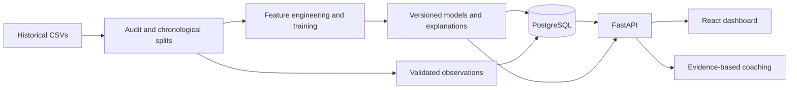

# ImpactAI

**Explainable performance analytics for historical professional VALORANT.**

ImpactAI connects a reproducible machine-learning pipeline to a FastAPI backend, PostgreSQL
storage, and a React dashboard. Explore a player's match history, inspect contextual performance,
compare pre-round predictions with recorded outcomes, and generate coaching review priorities
linked to the underlying evidence.

**132,280 player-game records · 13,228 games · 273,163 rounds · July 2020–January 2022**

[Project overview](docs/project-overview.md) · [Model results](docs/evaluation.md) ·
[Methodology](docs/methodology.md) · [Development guide](docs/development.md) · [API reference](docs/api.md)

> **Project status:** working local application and research pipeline. A hosted demo is planned.
> The data represents historical professional matches; it does not describe live ranked gameplay.

## What you can do

- **Explore players and matches.** Search and filter historical performances by player, agent,
  map, event, and date, with shareable selections and browser-history support.
- **Review pre-round predictions.** Compare calibrated win probabilities with recorded round
  outcomes using information available before each round.
- **Understand performance in context.** Inspect six component scores, training-only peer
  references, and experimental performance ranges for covered research observations.
- **Inspect model explanations.** View local and global SHAP contributions for player-model
  estimates, alongside calibration, baselines, and evaluation slices.
- **Build an evidence-based review plan.** Compare a performance with earlier same-agent games,
  distinguish repeated patterns from isolated dips, and follow each suggestion to its source.

The core workflow runs without a paid language-model API.

## Measured results

The active model artifact, `v1-1c8c8207cf73`, was evaluated on the supplied chronological test
partition after model selection and calibration were frozen.

### Pre-round win probability

All three models below were evaluated on the same **39,585 held-out rounds**. Lower log loss and
Brier scores are better; higher ROC-AUC is better.

| Model | Log loss ↓ | Brier ↓ | ROC-AUC ↑ |
|---|---:|---:|---:|
| Constant-prior baseline | 0.6931 | 0.2500 | 0.5000 |
| Logistic-regression baseline | 0.6637 | 0.2354 | 0.6144 |
| **Selected XGBoost + temperature calibration** | **0.6356** | **0.2235** | **0.6650** |

The selected model reduced log loss by **8.3% relative to the constant-prior baseline**.

### Retrospective player analysis

The separate postgame player model achieved **0.3623 log loss**, **0.1193 Brier score**, and
**0.9146 ROC-AUC** across **19,190 held-out player-game records**. It uses completed-game
statistics to estimate association with team victory. Its higher AUC is not evidence of causal
player impact or pregame forecasting ability.

The dashboard's contextual performance index is a separate, explicitly **heuristic** comparison
of combat, openings, damage, assists, objectives, and clutch counts.

[Full metrics](docs/evaluation.json) · [Evaluation report](docs/evaluation.md) ·
[Data audit](docs/data-audit.json)

## How the system works



| Layer | Technologies |
|---|---|
| Dashboard | Next.js, React, TypeScript, Tailwind CSS, Recharts |
| API and storage | FastAPI, Pydantic, SQLAlchemy, PostgreSQL, Alembic |
| Machine learning | pandas, NumPy, scikit-learn, XGBoost, SHAP |
| Testing and tooling | pytest, Playwright, Ruff, ESLint, Docker Compose, GitHub Actions |

### Evaluation safeguards

- **Series stay together.** Games and player records from the same esports series never cross
  the supplied training, validation, and test partitions.
- **Preprocessing fits training data only.** Encoders, imputations, and peer references do not
  learn from validation or test observations.
- **Round inputs are explicitly pre-round.** Current-round outcomes and economy fields with
  unverified timing are excluded. Team-order swaps produce complementary probabilities.
- **Selection precedes testing.** Separate chronological validation segments select and calibrate
  models. Evaluation includes baselines, calibration, contextual slices, and series-bootstrap intervals.
- **Research stays identifiable.** Later experiments use previously inspected development data;
  their results are not presented as a fresh independent test or silently promoted to the active model.

See [methodology](docs/methodology.md) for feature definitions, exclusions, explanations, and limitations.

## Run locally

### Full application

Requires Docker Compose, a running Docker daemon, Python 3 for extraction, and an authorized copy
of `ImpactAI_Clean_Training_Data.zip`. **Source data and trained model artifacts are not bundled**
because redistribution rights for the supplied data have not been established.

From the repository root:

```bash
cp .env.example .env
python3 scripts/extract_data.py /path/to/ImpactAI_Clean_Training_Data.zip

docker compose build
docker compose up -d db
docker compose run --rm api python -m ml.preprocessing.audit
docker compose run --rm api python -m ml.train
docker compose run --rm api alembic upgrade head
docker compose run --rm api python -m scripts.import_data
docker compose up -d api frontend
```

Open the dashboard at **http://localhost:3000** and API documentation at **http://localhost:8000/docs**.
Training can take several minutes and several GB of memory. The frontend starts after the API's
readiness check confirms that observations and active-model predictions are imported.

For native Python/Node setup, configuration, database details, and troubleshooting, see the
[development guide](docs/development.md). Compose defaults are intended for local development.

### Checks without the dataset

The automated software checks use small artificial fixtures. They require no private dataset,
trained models, or paid API. Use **Python 3.12** and **Node.js 22**; native XGBoost on macOS also
requires OpenMP (`brew install libomp`).

```bash
python3.12 -m venv .venv
source .venv/bin/activate
python -m pip install -r requirements.lock
python -m pip install --no-deps -e .
pytest -q -m 'not dataset'

cd frontend
npm ci
npm run lint
npm run build
npm run typecheck
npx playwright install chromium
npm run test:e2e
```

Browser tests start an isolated fixture API and frontend automatically. These fixtures never
populate application data or reported model metrics. GitHub Actions runs Python checks against
SQLite and PostgreSQL, frontend checks, desktop/mobile browser workflows, and container builds.

[Verification record](docs/verification.md) distinguishes executed checks from historical results
and checks that require the full dataset.

## Repository guide

| Path | Contents |
|---|---|
| [`frontend/`](frontend/) | Dashboard, charts, shared hooks, and browser tests |
| [`backend/`](backend/) | API, database models, migrations, repositories, coaching, and tests |
| [`ml/`](ml/) | Data audits, features, model training, evaluation, and explanations |
| [`scripts/`](scripts/) | Data extraction/import, research experiments, and artifact verification |
| [`docs/`](docs/) | Architecture, methodology, metrics, research reports, and setup instructions |

For reproducible experiment commands and artifact formats, see the [research guide](docs/research.md).

## Scope and next steps

The dataset lacks movement, positioning, utility timing, communication, and kill-event sequences.
The system cannot establish causal player contribution, rank/MMR, or kill-by-kill win probability
added. SHAP explains model behavior; coaching thresholds remain descriptive heuristics.

- [ ] Publish a working demo using data suitable for public distribution.
- [ ] Evaluate frozen candidates on a fresh chronological holdout.
- [ ] Have independent reviewers assess coaching relevance and usefulness.

The [validation plan](docs/validation-plan.md) defines the next evaluation steps.

---

Independent research project. Not affiliated with Riot Games.
