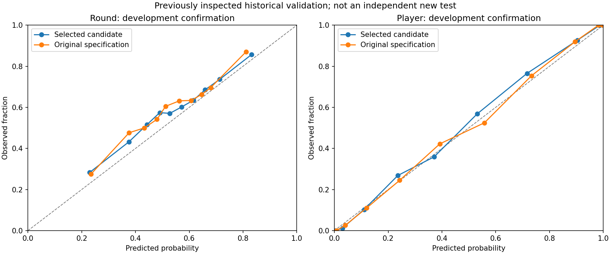

# Model improvement results — October 15, 2026

Completed the [predeclared experiment](2026-10-15-plan.md): 42 configurations, 84 expanding-window screening fits, and 10 finalist/baseline refits. All training ran in Linux with network access disabled. The original test partition was excluded from every model fit, ranking, calibration, and prediction in this experiment.

**These are development-validation results, not new held-out test results.** The comparison segment was part of previously inspected validation in the original project. The new protocol freezes model selection and calibration before accessing it, but that does not make the data historically unseen. Fresh later authorized data is required for an independent generalization claim.

| Task / calibrated model | Confirmation rows | Log loss ↓ | Brier ↓ | ROC-AUC ↑ | Accuracy ↑ |
|---|---:|---:|---:|---:|---:|
| Round / Original specification | 10,342 | 0.632602 | 0.222212 | 0.668175 | 62.82% |
| Round / Selected candidate | 10,342 | 0.627481 | 0.219740 | 0.676301 | 63.36% |
| Player / Original specification | 5,070 | 0.323409 | 0.105427 | 0.932873 | 84.20% |
| Player / Selected candidate | 5,070 | 0.311092 | 0.101607 | 0.937994 | 85.07% |

## What improved

- **Round**: `recent_ratings__flexible` reduced log loss by 0.81% relative to its matched baseline. Candidate-minus-baseline log-loss difference: -0.005122; 95% series-bootstrap interval [-0.008662, -0.001396] across 243 series. This quantifies this development comparison, not certainty about a new population.
- **Player**: `context__subsampled` reduced log loss by 3.81% relative to its matched baseline. Candidate-minus-baseline log-loss difference: -0.012317; 95% series-bootstrap interval [-0.015808, -0.008748] across 243 series. This quantifies this development comparison, not certainty about a new population.

The selected round model combines past-training team ratings with recent prior-round windows, previous streak, and half score. It uses 400 trees at depth 7 with learning rate .04. Neither current-round outcomes nor current-series final results can enter those inputs. Validation ratings remain frozen at the end of training.

The selected player model adds training-only standardized component values to the original individual features. It uses 600 trees at depth 6, learning rate .025, and row/column sampling .85/.9. It predicts postgame team-outcome association; it does not validate the heuristic index as causal individual impact.

## Limits and negative findings

- Pre-round accuracy is still about 63.4% and ROC-AUC about 0.676 on this segment. The measured gains do not justify calling the model extremely accurate.
- Team ratings alone were weaker than recent-round history in the training-fold screen. The combined feature set performed best in that screen.
- Added ACS/multi-kill features had the best training-fold player result, but lost to contextual features on the selection segment. The final choice was made before confirmation results were read.
- Candidate log loss improved on all seven map slices in this confirmation segment. Round ROC-AUC declined very slightly on Icebox; improvements are not uniform across every metric. Fracture has only 211 round rows / 100 player rows here, so that slice is too small for a strong map-generalization claim.
- Round calibration still shows visible discrepancies between predicted and observed rates. Raw source-team ordering is nonrandom; probability quality needs continued evaluation beyond aggregate AUC.
- More training alone does not establish a path to near-perfect prediction. Verified pre-round economy, reliable time-varying rosters/team strength, and a fresh chronological evaluation set are concrete data needs to investigate. Economy fields with unknown timing were not used.

## Partitions and provenance

Both tasks use 4,482 training series, then 480 selection, 238 calibration, and 243 confirmation series. Timestamp ties stay together. The two screening folds have expanding training windows with boundaries at:

- `fold1`: `2021-03-16 04:30:00`
- `fold2`: `2021-05-21 12:00:00`
- `select_end`: `2021-08-20 18:00:00`
- `calibrate_end`: `2021-09-24 21:25:00`

Run began `2026-10-15T22:53:37.330465+00:00` and completed `2026-10-15T22:56:36.444850+00:00`.
ML source SHA-256: `505e999f6e767e272a1114a90107843aa1d02147386b6bfe7330c4df0c7d527b`.

[Full configuration, fold metrics, selection scores, map slices, package versions, and source hashes](2026-10-15-results.json).

## Verification and saved candidates

- Full existing/new Python suite: **62 passed**. Added tests cover same-series/simultaneous-game leakage, frozen validation lookups, unknown teams, unreliable outcomes, shifted round history, perspective symmetry, temporal boundaries, and rejection of original test rows.
- Artifact verification checked 13 file hashes, source hashes, and the exact ML code hash before loading trusted local bundles.
- Reloaded both selected models and baselines on all confirmation records. Maximum saved-versus-reloaded probability difference was below `1.2e-7`.
- Team-swap complementarity passed on 1,000 round observations. TreeSHAP/calibration agreement passed on 512 spread-out player observations with maximum probability error below `8.35e-7`.
- Ruff lint/format passed. The candidate calibration figure was rendered and visually inspected.

Candidate root:

```text
ml/artifacts/research/search-20261015T225328Z
```

It contains `round-candidate.joblib`, `player-candidate.joblib`, frozen selection records, confirmation predictions, complete screening results, checksums, verification results, and `player-global-explanations.csv`.

These are research bundles with extra history/context inputs, not drop-in v1 API artifacts. The dashboard and its active model are unchanged. Activation requires feature-serving integration and evaluation on fresh authorized data. No background training job remains running.

## Calibration on the development confirmation segment


