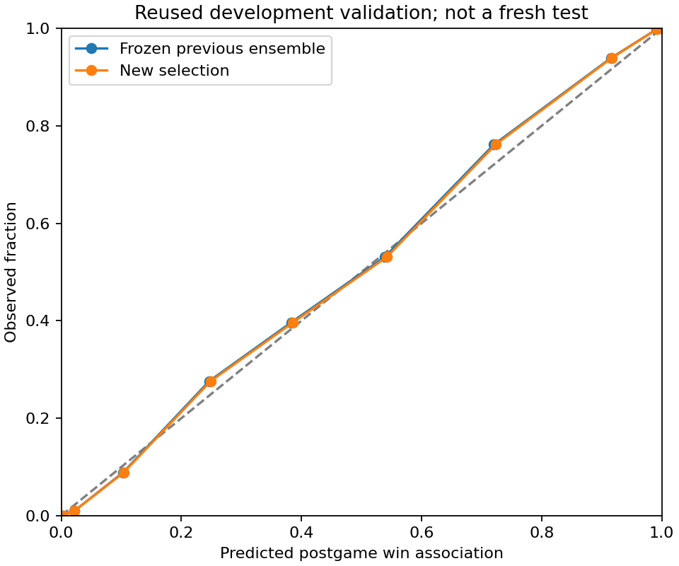

# Alternative learner and calibration results — October 16, 2026

Completed the [fixed search protocol](2026-10-16-final-search-plan.md): six native-categorical histogram-boosting recipes across three chronological training folds, two finalist refits, and 28 model/mixture/calibration comparisons. This required 40 boosted-model fits including inner early-stopping probes. No additional libraries, cloud compute, or external data were used.

**This is reused development validation, not an independent test.** All original test rows were excluded from every fit and prediction. Calibration-family choice used an earlier selection-fit segment and a later selection segment; final calibration used the separate 238-series calibration period. The final comparison covers 5,070 player-game rows / 243 series.

Frozen selection: **`previous::sigmoid`**. Calibration parameters: `{'kind': 'sigmoid', 'slope': 1.0334667658347338, 'intercept': 0.01297930473959493}`.

| Model | Log loss ↓ | Brier ↓ | ROC-AUC ↑ | Accuracy at 0.5 ↑ |
|---|---:|---:|---:|---:|
| Actual frozen previous ensemble | 0.306223 | 0.100863 | 0.938737 | 84.52% |
| New selection | 0.306112 | 0.100826 | 0.938737 | 84.50% |

Relative log-loss reduction: **0.036%**. Paired candidate-minus-previous loss difference: `-0.000111`; 95% series-bootstrap interval `[-0.00017485933025730317, -4.72310653711568e-05]`. This interval describes the reused comparison, not an independent generalization claim.

The best alternative-learner combination on the later selection segment was `mix_expanded__regularized_0.25::sigmoid` with log loss 0.339372. The chosen combination had selection loss 0.339294. All candidates and unsuccessful calibration methods are retained in the JSON report.

## Map checks

| Map | Rows | Previous loss | New loss |
|---|---:|---:|---:|
| Ascent | 1110 | 0.310100 | 0.310027 |
| Bind | 920 | 0.275822 | 0.275677 |
| Breeze | 550 | 0.352503 | 0.352624 |
| Fracture | 100 | 0.424288 | 0.423636 |
| Haven | 860 | 0.278346 | 0.278201 |
| Icebox | 970 | 0.312769 | 0.312543 |
| Split | 560 | 0.313418 | 0.313410 |

Agent, patch, and length slices are saved in the full JSON. These slices were not used to revise the frozen selection. Small groups are descriptive and noisy.

## Verification and limits

- All 7 artifact hashes, source hashes, model-source hash, and training-script hash matched before loading the trusted local bundle.
- Reloaded all 5,070 predictions exactly and proved the reference predictions match the actual previous artifact by game/player keys.
- Mutating identity and outcome fields did not affect inference. Fourteen new tests cover native categorical fallback, missing values, calibration, chronological boundaries, and mixture validation.
- The complete Python suite passed **93 tests**. No frontend behavior was changed in this run.
- Explanation checks: `[{'source': 'previous', 'member': 0, 'method': 'TreeSHAP (tree-path dependent)', 'scale': 'uncalibrated log-odds', 'rows': 512, 'max_error': 8.940696716308594e-07}, {'source': 'previous', 'member': 1, 'method': 'TreeSHAP (tree-path dependent)', 'scale': 'uncalibrated log-odds', 'rows': 512, 'max_error': 9.5367431640625e-07}, {'source': 'previous', 'member': 2, 'method': 'TreeSHAP (tree-path dependent)', 'scale': 'uncalibrated log-odds', 'rows': 512, 'max_error': 1.8775463104248047e-06}]`.
- Explanation additivity verifies the calculation, not the causal truth or stability of feature attribution. Permutation explanations, if used, are sampled approximations on encoded features with a training-only background.
- Probability calibration changes how scores map to probabilities; it does not establish that a player's actual contribution or coaching needs were measured correctly.
- No classification threshold was optimized against the final comparison. Neither the heuristic impact index nor the component-specific peer benchmark was retuned in this run.

Artifacts: `ml/artifacts/research/player-calibration-20261016`. Training started `2026-10-17T03:20:22.829639+00:00` and completed `2026-10-17T03:22:17.063632+00:00`. The new selection remains a research bundle; the application continues using its existing active artifact.

```bash
python -m scripts.optimize_player --parent ml/artifacts/research/player-20261016-v2 --output ml/artifacts/research/NEW_RUN
python -m scripts.verify_player_optimization ml/artifacts/research/NEW_RUN --report docs/experiments/NEW-results.md
```


