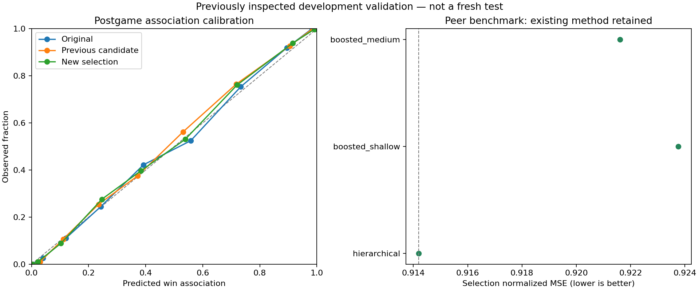

# Postgame player training results — October 16, 2026

Completed the [declared player-only experiment](2026-10-16-plan.md). All training used the supplied historical professional esports data and four local CPU threads. Original test rows were excluded from fitting, selection, calibration, and predictions.

**The results below reuse historical validation; they are not an independent new test.** The 5,070 player rows cover 243 series. Selection used an earlier 480-series validation segment and temperature calibration a separate 238-series segment. Three expanding folds within original training screened candidates, and inner chronological windows selected tree counts.

## Postgame outcome association

| Model | Log loss ↓ | Brier ↓ | ROC-AUC ↑ | Accuracy ↑ |
|---|---:|---:|---:|---:|
| Original specification | 0.323409 | 0.105427 | 0.932873 | 84.20% |
| Frozen previous research candidate | 0.311092 | 0.101607 | 0.937994 | 85.07% |
| Previous specification, native refit | 0.310547 | 0.101412 | 0.938266 | 85.03% |
| New selection: diverse_average | 0.306223 | 0.100863 | 0.938737 | 84.52% |

Relative log-loss reduction versus the previous specification refit: **1.39%**. Candidate-minus-previous loss: -0.004324; 95% series-bootstrap interval [-0.007307692722215456, -0.0012088718422758216]. This interval describes the reused development comparison, not a fresh generalization estimate.

Versus the actual frozen previous candidate, log loss decreased **1.57%**. The matched frozen-prediction comparison is saved as `frozen-previous-comparison.json`; its series-bootstrap loss-difference interval is [-0.007785, -0.001632]. The selected model averages three equally weighted members with 1,937, 1,383, and 1,480 trees before temperature calibration.

Accuracy at the fixed 0.5 cutoff declined despite lower log loss. The selection objective was probability quality; the result is not an across-the-board improvement. The prior candidate's refit and its frozen artifact produce slightly different predictions, so both are retained when the previous run is supplied.

The label is the team's completed-match outcome. These metrics do not validate individual causal impact, coaching quality, or a player's future win probability. Exact match length, plants, defuses, and survival-related statistics describe the completed match; their predictive association cannot be interpreted as a causal improvement prescription.

Log loss improved on 6 of 7 map slices. Small slices can fluctuate substantially; these exploratory slice results were not used to revise the frozen selection.

| Player coverage | Rows | Previous loss | Selected loss | Selected ROC-AUC |
|---|---:|---:|---:|---:|
| seen_in_training | 3904 | 0.321700 | 0.317241 | 0.934279 |
| unseen_in_training | 1166 | 0.273203 | 0.269331 | 0.949162 |

Player identity is used only to define these evaluation groups; it is never a model input.

## Outcome-free player comparisons

Selected benchmark: **hierarchical**. Mean training-variance-normalized squared error changed from 0.976376 to 0.976376 (**0.00% reduction**). The target is each player's measured performance component, not the match winner. At inference, only agent, map, patch, and match length determine expected values.

| Component | Hierarchical baseline error | Selected error | Reduction |
|---|---:|---:|---:|
| Combat | 1.101622 | 1.101622 | 0.00% |
| Openings | 0.976879 | 0.976879 | 0.00% |
| Damage | 1.165307 | 1.165307 | 0.00% |
| Assists | 0.869538 | 0.869538 | 0.00% |
| Objectives | 0.801336 | 0.801336 | 0.00% |
| Clutches | 0.943574 | 0.943574 | 0.00% |

Paired mean-error comparison: `{'difference': 0.0, 'series_bootstrap_95pct': [0.0, 0.0], 'series': 243}`.

Expected means support component-by-component comparisons. This experiment does not train a calibrated percentile distribution or validate new weights for a composite impact score. The existing heuristic impact score is not replaced by either model's win probability.

A separately declared [component-specific follow-up](2026-10-16-peer-followup-results.md) subsequently reduced peer-mean error by **0.175%**, using learned means for combat, openings, damage, and clutches while retaining hierarchical means for assists and objectives. Its exploratory status and selection rule are documented separately.

## Verification and reproducibility

- Verified 13 artifact hashes and all source/code hashes before deserializing trusted local bundles.
- Reloaded all 5,070 confirmation rows for every saved association/peer model and matched their predictions.
- Checked TreeSHAP reconstruction on 512 observations per selected member, including the actual ensemble probability/temperature arithmetic.
- Verified peer means remain identical when observed stats and outcome labels are changed at inference.
- Saved map, agent, patch, length, and seen/unseen-player association slices; peer slices and keyed observed/expected component evidence are also available.
- Retained every screening/selection result, early-stopping count, specification, source snapshot, and negative finding.
- Python verification: **75 tests passed** for the expanded application/ML suite, then **4 additional tests passed** for component selection and composition. Ruff lint/format passed for 52 files. The calibration figure was visually inspected.

The searches performed 145 boosted-model fits in total: 85 classifier fits including early-stopping probes, 48 component-regression fits in the initial peer search, and 12 regression fits in the component follow-up. Both training processes exited successfully; no continuing training job was launched.

Run directory: `ml/artifacts/research/player-20261016-v2`. Started `2026-10-16T05:10:19.184866+00:00`; completed `2026-10-16T05:16:18.403361+00:00`.

Reproduce with `python -m ml.player_research --output ml/artifacts/research/NEW_DIRECTORY`. Verify using `python -m scripts.verify_player_research DIRECTORY --report docs/experiments/NEW-results.md`. A run's `ml-source.zip` preserves the exact source needed if later edits change the code hash.

The saved models are research candidates. Activating them requires feature-serving integration and an explicit evaluation/release decision. Fresh authorized later matches and independently reviewed player-performance labels are needed before making stronger performance claims.

