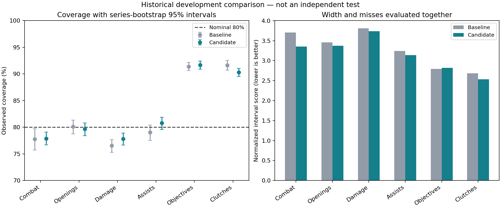

# Contextual peer intervals — October 17, 2026

Completed the [fixed protocol](2026-10-17-peer-interval-plan.md): **72 quantile-regressor fits**, covering six components, three quantiles, three chronological screening folds, and a full-training refit. All six learned components improved selection pinball loss in every fold and the earlier selection period. Selection was frozen before calibration and final diagnostic inference.

**This is reused development validation, not a fresh test.** The comparison uses 5,070 player-game records in 243 series. Original test rows were excluded throughout. Inputs are agent, map, patch, length band, and round count; outcomes, player/team identity, and the player's observed statistics are excluded from model inputs.

The models estimate an expected range for each performance component among comparable historical records. The 10th/90th quantiles form a nominal 80% interval; the median is also predicted. These are ranges of individual observations, not confidence intervals for a mean or an impact score.

| Calibrated model | Normalized interval score ↓ | Normalized pinball loss ↓ |
|---|---:|---:|
| Empirical agent/map baseline | 3.283993 | 0.230171 |
| Learned conditional ranges | 3.160698 | 0.225441 |

Interval score improved **3.75%** and pinball loss improved **2.05%**. Interval score penalizes both overly wide ranges and observations outside the range. The paired mean score difference was -0.123296, with series-bootstrap 95% interval [-0.14216721546512795, -0.10537487283963518]. This uncertainty describes the reused development comparison, not independent generalization.

## Component results

| Component | Baseline coverage | Learned coverage | Interval-score change |
|---|---:|---:|---:|
| Combat | 77.79% | 77.87% | -9.51% |
| Openings | 80.10% | 79.68% | -2.43% |
| Damage | 76.55% | 77.81% | -1.93% |
| Assists | 79.05% | 80.77% | -3.08% |
| Objectives | 91.40% | 91.70% | +0.94% |
| Clutches | 91.62% | 90.32% | -5.80% |

Five components improved interval score, but **objectives worsened**. That negative result is retained; the frozen component selection was not changed after inspecting this period. Combat and damage coverage remained below nominal 80%, and damage misses were skewed toward unexpectedly high damage. Objectives and clutches have many zeros and discrete values, so their coverage exceeded 90%. The mean coverage across components must not be interpreted as prediction accuracy or simultaneous coverage.

Calibration used only the separate 5,420-row / 238-series calibration period. Series dependence, temporal drift, and sparse outcomes mean no IID conformal coverage guarantee is claimed. Map, agent, and match-length slice coverage and tail errors are retained in the JSON; small slices are descriptive.

## Verification and status

All 7 artifact hashes and source/script/ML fingerprints passed. All 5,070 predictions reloaded exactly. The verifier rebuilt empirical references and calibration expansions, recomputed selection and interval metrics, and confirmed predictions stay identical when all noncontext columns are removed. Automated tests also cover unseen categories, support, quantile ordering, finite-rank calibration, partition isolation, and portable serialization.

The candidate remains research-only. The active dashboard model and heuristic score are unchanged. These results improve a measured peer-comparison capability; they do not establish causal impact, coaching effectiveness, or modern-ranked-game validity. New later matches and human-reviewed performance benchmarks are still needed.

Artifacts: `data/research/peer-intervals-20261017`. Started `2026-10-17T22:39:48.067079+00:00`; completed `2026-10-17T22:40:42.172526+00:00`.

```bash
python -m scripts.peer_intervals ml/artifacts/research/player-20261016-v2 --output data/research/NEW_INTERVAL_RUN
python -m scripts.verify_peer_intervals data/research/NEW_INTERVAL_RUN --report docs/experiments/NEW-interval-results.md
```


