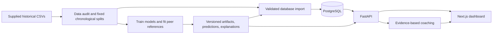

# ImpactAI: project overview

ImpactAI is a working local VALORANT analytics application for reviewing **historical professional player performances**. It combines contextual statistics, machine learning, explanations, and an evidence-based coach. The practical workflow is: search for a player, open one of their matches, inspect the component breakdown and peer comparisons, then generate review priorities grounded in that record.

The supplied data covers July 2020–January 2022: **13,228 map-games, 6,404 series, 7,211 player IDs, 132,280 player-game records, and 273,163 rounds**. It is not a live Riot integration or a modern ranked-game dataset.

## How the pieces work together

**Data processing.** The audit checks schemas, missing values, observation keys, five-player teams, score progression, outcome consistency, and chronological separation. Original source bytes are preserved and hashed. A source-labeled 14–14 win and an incomplete 5–6 game are retained as observations but excluded from supervised player-outcome training. Unknown economy timing, extremely sparse KAST, and uncertain overtime sides are not silently filled with invented facts.

**Training.** Pandas/NumPy prepare allowed features; scikit-learn and XGBoost fit statistical models. All observations from the same esports series stay in the same time partition. Encoders, missing-value handling, and peer references are fitted on training data. Versioned artifacts contain models, feature schemas, evaluation results, explanations, predictions, source hashes, and package metadata.

**Storage and serving.** SQLAlchemy models and Alembic migrations organize matches, games, teams, players, player-game stats, rounds, model versions, predictions, and coaching reports in PostgreSQL. The importer is transactional and idempotent. FastAPI/Pydantic exposes typed endpoints with filtering, pagination, and version metadata. Historical predictions are materialized, so ordinary page requests do not retrain a model or reread all CSVs. The pre-round analysis endpoint also supports inference from explicitly supplied valid pre-round context.

**Dashboard.** Next.js, React, TypeScript, Tailwind, and Recharts provide overview, players, match details, agents, model insights, and coaching pages. The interface shows statistics, trends, component breakdowns, explanation charts, and observed-versus-predicted round timelines. Docker Compose packages the database, API, and frontend. SQLite is supported for local smoke tests; PostgreSQL is the deployment database.

## What each score means

| Output | How it is produced | What it tells you |
|---|---|---|
| Contextual index and percentile | Six standardized components, smoothed training-only peer groups, equal-weight 0–100 formula | A descriptive comparison with historical peers; explicitly heuristic |
| Postgame win association | Individual end-of-game stats plus agent/map/patch/length context | How the observed statistical performance relates to the team's completed-game outcome |
| Component peer means | Hierarchical references; research candidates also learn selected component means from context | Whether combat, openings, damage, assists, objectives, or clutches exceeded the expected historical reference |
| Component peer ranges (research) | Context-only quantile regressors with a separate interval-calibration period | Whether a statistic falls outside the expected historical range; coverage is measured empirically |
| Pre-round win probability | Information known before that round, such as prior score, map, patch, and valid side | A probability for the upcoming round, not a kill-by-kill contribution |
| Model explanation | SHAP or explicitly identified model-specific explanation methods | Which inputs moved a model output relative to its reference; not proof of causation |

The contextual index combines combat efficiency, opening engagements, damage, assists, objective participation, and clutch counts. Small peer groups fall back toward broader groups. Score, percentile, peer count, fallback level, and raw component evidence remain visible. **The win-association probability is never relabeled as an individual impact score.**

The coach describes strengths, neutral context, and review priorities from actual component values and peer means. It compares up to nine earlier same-agent games from earlier series, labels repeated patterns versus isolated dips or limited history, and permits a no-clear-weakness result. The thresholds are heuristic and require human validation. It attaches source game/player/metric references and gives bounded suggestions such as reviewing opening engagements in a VOD. It works without a paid language-model API. An optional provider can reorder verified evidence items; arbitrary provider prose and invented statistics are not accepted.

## Current application versus research candidates

The application's active artifact is **`v1-1c8c8207cf73`**. Its original historical test results are player ROC-AUC **0.9146** and pre-round ROC-AUC **0.6650**. See the [original evaluation](evaluation.md).

Subsequent research trained richer individual features, longer boosting runs, ensembles, outcome-free peer regressors, and alternative calibration methods. Those candidates are saved separately from the active application model. Their reported improvements use previously inspected development validation, so their numbers must not be compared directly with the application's original test metrics as if the samples were identical.

The [latest training report](experiments/2026-10-17-peer-interval-results.md) evaluates contextual performance ranges. Earlier [player experiments](experiments/2026-10-16-results.md), [calibration search](experiments/2026-10-16-final-search-results.md), and [component-specific benchmark follow-up](experiments/2026-10-16-peer-followup-results.md) retain their configurations and negative findings. Integrating a research candidate requires matching its features, calibration, and explanation behavior to the serving contract and regenerating versioned database predictions; saving a trained bundle does not silently activate it. The dashboard now has a separate experimental view of saved peer-range comparisons for matching development-sample observations; this does not promote the research predictor or change the active index.

The classifier search completed **40 additional boosted-model fits** and 28 probability/calibration comparisons. The existing three-member XGBoost ensemble remained the selection winner. A sigmoid calibrator reduced development log loss from **0.306223 to 0.306112** (0.036%); ROC-AUC stayed **0.938737**, and accuracy at the fixed 0.5 cutoff decreased from **84.52% to 84.50%**. This is a very small probability adjustment, not evidence of a breakthrough in individual-performance analysis. The separate component-specific peer benchmark previously reduced expected-statistic error by 0.175%.

The latest continuation completed **72 quantile-regressor fits** to learn performance ranges from agent, map, patch, and match length. On the same reused development segment, calibrated interval score improved **3.75%** and quantile prediction loss improved **2.05%** relative to empirical peer ranges. Five components improved interval score; objectives worsened. Nominal 80% intervals covered about 77.9% of combat and 77.8% of damage observations, while sparse objectives/clutches exceeded 90%. These mixed coverage results are retained, and no independent generalization or guaranteed-coverage claim is made.

## What is verified, and what remains limited

Automated checks cover data integrity, chronological isolation, feature exclusion, frozen peer references, unknown categories, probability arithmetic, round team-swap symmetry, artifact serialization/hashes, database constraints, API responses, coaching grounding, and frontend workflows. Detailed execution records are in [verification](verification.md). Readiness checks distinguish a reachable database from a fully imported model version.

The October 17 Python run passed **115 tests**, the PostgreSQL contract suite passed **14 checks**, and all **eight desktop/mobile browser workflows** passed. Frontend lint, type checking, and production build also passed in that October run. See the November 10 entry in [verification](verification.md) for the current application changes and checks. All 5,070 saved development interval predictions reloaded exactly; empirical references, calibration, selection, and interval metrics were independently recomputed. Earlier classifier explanation reconstruction passed on 512 observations for each of the selected ensemble's three members. Application fixes address missing-prediction handling, missing probability chart values, and local database query/concurrency behavior.

These checks support the implemented behavior; they do not prove every possible input is correct or that the model is globally optimal. More training can improve a metric without improving every other metric. A new model is not automatically preferable just because it is larger or newer.

The dataset lacks positions, movement, utility timing, communication, event-level kill sequences, reliable current economy, and modern ranked matches. The system cannot substantiate causal player impact, Riot rank/MMR/RR, actual kill-by-kill win probability added, or tactical claims about an unobserved event. Clutch counts lack attempt denominators. Independent later matches and human-reviewed performance benchmarks are needed to assess broader player-analysis quality.

Use the [README](../README.md) for setup, reproducible training, imports, tests, and local startup. This is a functional local application and research pipeline; no public production deployment has been performed.
